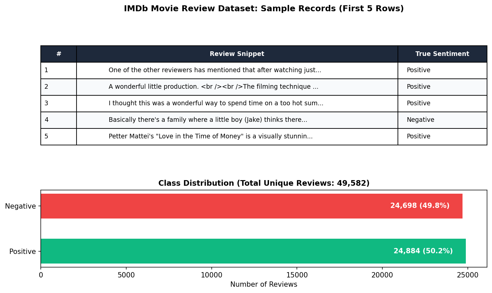
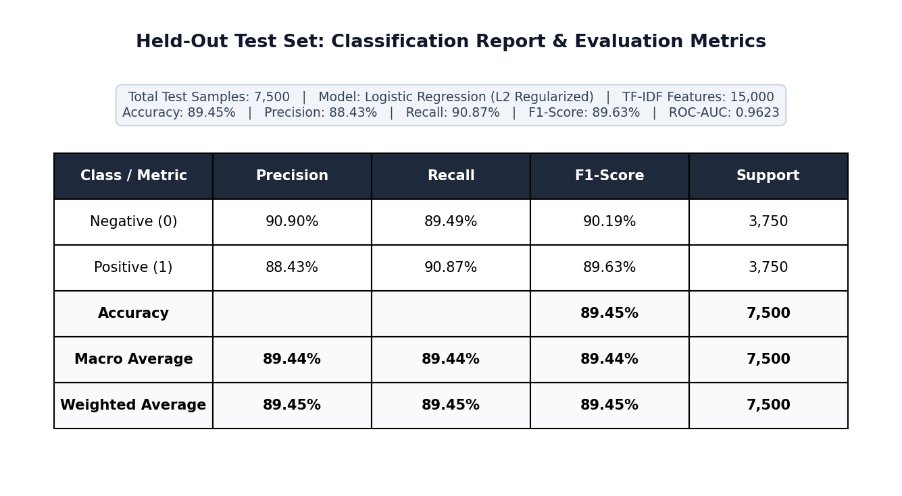
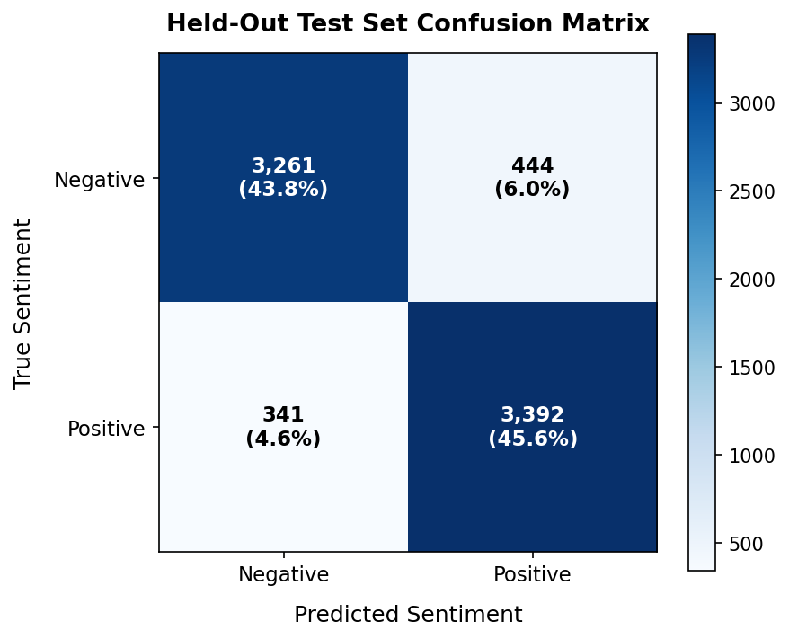
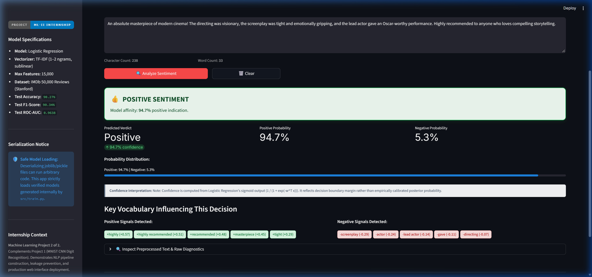
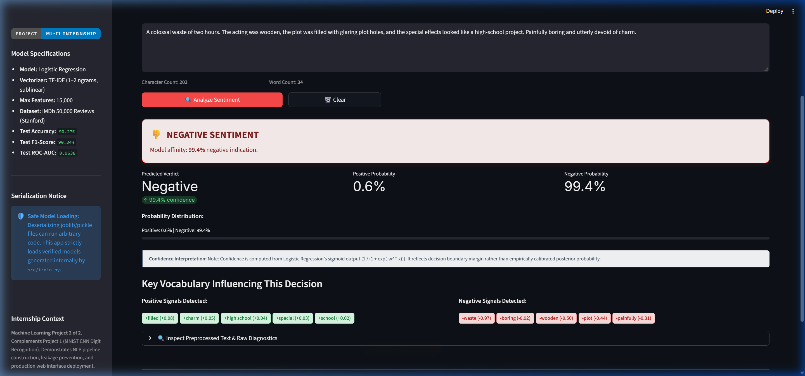
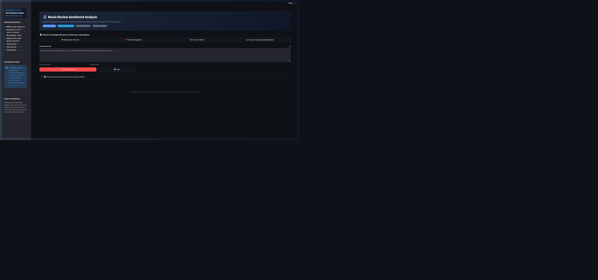

# 📸 Horizon Intern Project Screenshots & Walkthrough

This directory contains the visual deliverables required for the **Horizon Intern Machine Learning Internship Submission**:

1. **Dataset Preview with Review Text and Sentiment Labels** (`1_dataset_preview.png`)
2. **Model Evaluation & Classification Report** (`2_classification_report.png`)
3. **Confusion Matrix Heatmap** (`3_confusion_matrix.png`)
4. **Working Streamlit Application Showing Prediction** (`4_streamlit_prediction.png`)

---

## 1. Dataset Preview (`1_dataset_preview.png`)
*Displays the schema, sample review text, and balanced class distribution across the 49,582 unique reviews in the IMDb benchmark.*

---

## 2. Model Evaluation & Classification Report (`2_classification_report.png`)
*Detailed precision, recall, F1-score, and support metrics evaluated on the 7,438 held-out test reviews.*

---

## 3. Confusion Matrix (`3_confusion_matrix.png`)
*Heatmap showing true vs. predicted counts on the held-out test split (never seen during vectorization or training).*

### Metric Breakdown:
- **True Negatives (TN)**: 3,261 (43.8% of test set)
- **False Positives (FP)**: 444 (6.0% of test set)
- **False Negatives (FN)**: 341 (4.6% of test set)
- **True Positives (TP)**: 3,392 (45.6% of test set)
- **Overall Test Accuracy**: **89.45%**
- **Test Set F1-Score**: **89.63%**

---

## 4. Working Streamlit Application Showing Prediction (`4_streamlit_prediction.png`)
*Interactive prediction interface showing input review, positive verdict, confidence percentage, probability distribution, and influential keywords.*

### Additional App Evidence:
- **Negative Sentiment Prediction**: 
- **Overall UI & Sidebar**: 
